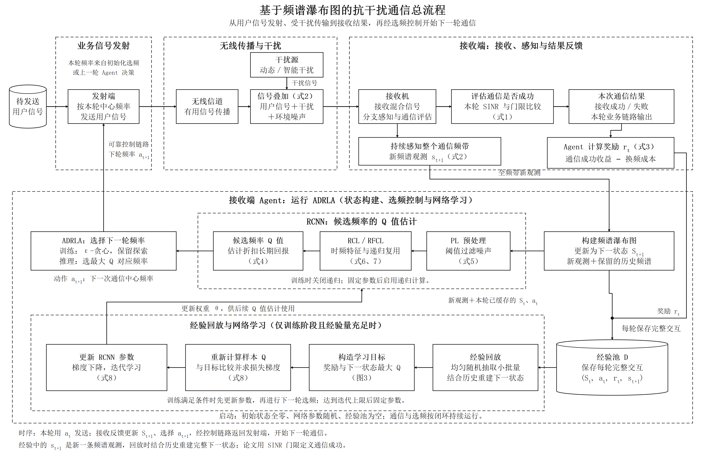

# Reference Flowchart｜科研与程序流程图

[](https://github.com/zainxx4536/reference-flowchart/actions/workflows/ci.yml)

一个面向 Codex 的中文流程图技能：依据论文、代码或流程说明，梳理完整主线、输入输出和反馈，再参照用户提供的图片绘制流程图，交付可编辑 SVG、可浏览 HTML 和高清 PNG。

默认采用白底黑线、宋体类中文字体、虚线分区和直角模块；用户提供的参考样式优先。技能独立工作，不依赖 Diagram Design 插件。

## 示例效果

下面是依据 *Anti-Jamming Communications Using Spectrum Waterfall: A Deep Reinforcement Learning Approach* 制作的流程图，展示物理信号主线、选频控制和经验回放支路。



- [高清 PNG（4560 × 2940）](example/示例_论文主线流程图.png) · [可编辑 SVG](example/示例_论文主线流程图.svg) · [HTML](example/示例_论文主线流程图.html)
- [案例输入 JSON](example/paper-flowchart.json) · [解析后的布局](example/示例_论文主线流程图.layout.json) · [运行检查报告](example/示例_论文主线流程图.validation.json)
- [来源对应说明](references/paper-case.md) · [原论文 DOI](https://doi.org/10.1109/LCOMM.2018.2815018)

仓库不分发论文 PDF。复现已有图件只需案例 JSON；重新核对论文语义时，请自行提供有权使用的原文。

另外提供 [通用闭环示例](assets/example-flowchart.json) 和 [分支与布局辅助示例](assets/branching-flowchart.json)。它们是独立演示，不代表实际业务，也不会生成上面的论文案例图。

## 能力与边界

| 能力 | 实现方式 |
| --- | --- |
| 来源核对 | Codex 阅读本次论文或代码，核对输入、输出、模块归属、时序和式号 |
| 绘图 | Python 标准库把布局 JSON 生成 SVG、HTML 和布局副本 |
| 规格校验 | 仓库内 JSON Schema 配合图关系检查，错误定位到 `$.nodes[0].font_size` 等字段 |
| 常用形状 | 矩形 `rect`、圆柱 `cylinder`、判断菱形 `diamond`、起止节点 `terminator` |
| 布局辅助 | 节点对齐、等间距分布、绕开节点的正交连线路由 |
| 来源追溯 | 节点和连线支持 `sources`，区分论文、代码和建议设计；HTML 和报告保留定位记录 |
| 导出与检查 | Playwright 导出 PNG，检查形状边界、文字、叠线、交叉和窗口适配，并记录运行环境、字体及文件哈希 |

脚本不会自动理解论文，也不提供整个图的自动布局。对齐和路由不能替代整体布局设计；自动路由避开节点，不会自动避开所有文字和其他连线。自动几何检查通过后，仍须查看图片并核对来源。

## 依赖与安装

| 用途 | 依赖 |
| --- | --- |
| 生成 SVG／HTML、校验 JSON | **Python ≥ 3.10**，只用标准库，无需安装 Python 包 |
| PNG 导出、环境自检、Node 测试 | **Node.js ≥ 22**，以及锁定版本的 Node `playwright` |
| 截图 | 已有 Chromium／Chrome／Edge，或 Playwright 配套 Chromium |
| 中文显示 | 可用的中文字体，或显式提供本地 OTF／TTF／WOFF 字体文件 |
| 使用技能理解材料 | 支持本地技能的 Codex，以及宿主已有的论文、代码和图片读取能力 |

直接运行绘图脚本不需要 OpenAI API Key。Codex 分析材料仍使用你已有的账户或模型配置。PDF 阅读工具不是绘图脚本的依赖，扫描件需要宿主另行具备 OCR 能力。

克隆仓库并安装锁定的 Node 依赖：

```powershell
git clone https://github.com/zainxx4536/reference-flowchart.git
cd reference-flowchart
npm ci --ignore-scripts
```

`package.json` 和 `package-lock.json` 固定 Playwright **1.62.1**。此命令下载 npm 包，不安装浏览器。已有 Chrome／Edge 时可以直接使用；需要配套 Chromium 时，由使用者主动执行：

```powershell
npx playwright install chromium
```

Linux 的浏览器系统库可按 [Playwright 官方浏览器文档](https://playwright.dev/docs/browsers) 准备，例如 `npx playwright install --with-deps chromium`。脚本本身不会联网安装依赖、浏览器或字体。

## 环境自检

在仓库根目录执行：

```powershell
npm run check:env
```

自检实际启动浏览器，检查 Python、Node、Playwright、浏览器路径和中文探针字形。结果为 `ready` 时返回退出码 0；缺少依赖或启动失败时为 `not-ready` 并返回非零退出码。

可用命令行参数指定已有依赖：

```powershell
npm run check:env -- --python "C:/Python/python.exe" --browser-path "C:/Program Files/Google/Chrome/Application/chrome.exe"
```

也支持下列环境变量；命令行参数优先：

| 环境变量 | 用途 |
| --- | --- |
| `FLOWCHART_PYTHON` | Python 可执行文件路径，用于自检、演示和测试入口 |
| `FLOWCHART_PLAYWRIGHT_MODULE` | 已有 Node Playwright 包目录；默认先查仓库安装，再查可用的 Codex 工作区运行时 |
| `FLOWCHART_BROWSER_PATH` | Chromium／Chrome／Edge 可执行文件路径 |
| `FLOWCHART_FONT_PATH` | 本地字体文件，导出时临时加载，不安装到系统 |

默认字体族依次为 SimSun、Songti SC、Noto Serif CJK SC、serif。环境自检用 Chromium 协议记录中文探针**实际使用的字体**，并检查示例字形；这不代表所有字符都已逐一验证。更换字体后应重新导出和查看图件。

需要统一不同机器的字体时，可以提供自己有权使用的本地字体：

```powershell
$env:FLOWCHART_FONT_PATH = "C:/fonts/your-font.otf"
npm run demo
```

也可为自检和 PNG 导出命令追加 `--font-path "C:/fonts/your-font.otf"`。字体只在本次浏览器渲染时加载，SVG／HTML 文件仍保留字体族声明，未内嵌该字体。字体文件最大 32 MiB。

## 快速运行

以下命令均在仓库根目录执行，可重复运行；演示入口只覆盖自身在 `output/` 下的同名演示文件。

```powershell
npm run demo
npm run example:paper
```

`npm run demo` 生成通用闭环和分支示例，`npm run example:paper` 根据案例 JSON 生成论文流程图。输出分别为：

| 示例 | 输出基名 | 默认 PNG 尺寸 |
| --- | --- | --- |
| 通用闭环 | `output/example-flowchart` | 3000 × 2060 |
| 判断、起止及布局辅助 | `output/branching-flowchart` | 2800 × 1900 |
| 论文案例 | `output/paper-flowchart` | 4560 × 2940 |

每个基名对应 `.svg`、`.html`、`.layout.json`、`.png` 和 `.validation.json`。HTML 可直接用浏览器打开，支持适应窗口、原尺寸查看，以及展开节点和连线的来源记录。

需要自己控制输出路径时，分两步运行：

```powershell
python scripts/render_flowchart.py assets/example-flowchart.json --output-base output/my-flowchart
node scripts/export_png.cjs output/my-flowchart.html
```

只验证输入、不写文件：

```powershell
python scripts/render_flowchart.py assets/branching-flowchart.json --validate-only
```

默认拒绝覆盖输出，确认文件属于本次任务后可为对应命令追加 `--overwrite`。PNG 支持 `--scale 1` 至 `--scale 4`，默认 2 倍。`python`／`node` 不在 PATH 时，用真实可执行路径代替；PowerShell 调用带空格的可执行路径时，在前面加 `&`。

生成器输出的 SVG、HTML 与布局 JSON 必须保持配套。导出会核对布局哈希及 HTML 中的 SVG 是否与独立 SVG 一致；修改输入后重新运行生成和导出步骤。新版本导出器要求重新生成旧版图件。

## 让 Codex 使用技能

按照 [OpenAI 官方技能文档](https://learn.chatgpt.com/docs/build-skills)，可把完整仓库放在项目的 `.agents/skills/reference-flowchart/` 或用户目录的 `~/.agents/skills/reference-flowchart/`。例如在目标项目根目录执行：

```powershell
New-Item -ItemType Directory -Force -Path ".agents/skills" | Out-Null
git clone https://github.com/zainxx4536/reference-flowchart.git ".agents/skills/reference-flowchart"
```

在技能目录中按需执行 `npm ci --ignore-scripts`。避免重复安装同名技能；目录已存在时先检查其内容。Git 克隆的技能可用 `git pull --ff-only` 更新。

Codex 通常自动发现技能；未显示时可重启后检查。使用示例：

```text
请使用 $reference-flowchart，依据我提供的论文或代码，
参照所附图片的视觉形式绘制完整流程图。
保留输入输出、控制反馈和材料确有的学习支路；涉及公式只标原文式号。
关键节点写入来源定位，输出到当前工作区 output/，交付 SVG、HTML 和高清 PNG。
```

用于新论文时必须重新建立模块、连线和式号；参考图片中的业务内容不自动成为新图的事实。

## 文件职责与阅读顺序

先看本 README，再看 [SKILL.md](SKILL.md)。编辑 JSON 时看 [格式与布局说明](references/spec-format.md)；只有复用论文案例时看 [来源记录](references/paper-case.md)。

```text
reference-flowchart/
├── SKILL.md、agents/openai.yaml      Codex 技能指令与显示信息
├── package.json、package-lock.json   Node 依赖和便捷命令
├── schemas/flowchart.schema.json     JSON 编辑器可用的输入规格
├── scripts/
│   ├── render_flowchart.py           Python 命令入口
│   ├── flowchart_spec.py             标准库规格及图关系校验
│   ├── layout_helpers.py             对齐、等距与正交避障路由
│   ├── export_png.cjs                PNG 导出命令入口
│   ├── check_env.cjs                 环境、浏览器及字体自检
│   ├── flowchart.cjs、run_tests.cjs   演示与测试入口
│   └── lib/                         绘图检查和运行时共用模块
├── assets/                          通用闭环、分支 JSON 示例
├── example/                         论文案例 JSON 和可编辑图件，无论文 PDF
├── references/                      按需读取的格式与案例说明
├── tests/                           输入、几何、文件一致性及真实浏览器回归
└── .github/workflows/ci.yml          Windows、Linux、macOS 测试矩阵
```

入口脚本供命令行执行，共用模块由脚本内部导入。`output/`、`node_modules/` 和缓存不会提交到仓库。

## 检查与测试

```powershell
npm test
npm run test:unit
```

`npm test` 运行 Python、Node 几何和真实浏览器测试；`test:unit` 仅运行不需要浏览器的部分。用例包含正常图件、错误字段、无效引用、父分区循环、自动绕障、越框、叠线、端点接触、文字压线、来源记录及文件错配。

检查报告含 `issues`、运行时版本、中文探针实际字体、PNG 尺寸、窗口适配、输入／图件哈希及来源记录。`layout-pass` 表示自动项目通过；`needs-fix` 会返回非零退出码，并保留 PNG 和报告供修正。文字检查结合 SVG 字符位置与 Canvas 字形边界，减少不同字体全局度量造成的误报。

CI 配置在 Windows、Linux 和 macOS 上使用 Python 3.12、Node 22、锁定的 Playwright 与配套 Chromium。为了统一字体，CI 显式运行 `tests/prepare_ci_font.py`，下载校验 SHA-256 的 Noto Serif CJK SC 字体及其 OFL 声明，再通过 `FLOWCHART_FONT_PATH` 使用；字体不随仓库分发，应用脚本和 `npm test` 不会自动下载字体。各平台实测状态以 [GitHub Actions](https://github.com/zainxx4536/reference-flowchart/actions/workflows/ci.yml) 为准。

本地已验证 Windows、Python 3.14.5、Node 22.22.3、Playwright 1.62.1 和系统 Chrome，使用宋体及显式 Noto 字体分别检查图件。不同平台／字体的像素结果可能不同，固定尺寸和检查结果不代表逐像素一致。

## 常见问题

| 现象 | 处理方式 |
| --- | --- |
| Python 或 Node 找不到／版本过低 | 先运行自检；用实际可执行路径或 `FLOWCHART_PYTHON` 指定 Python |
| Node Playwright 找不到 | 在仓库运行 `npm ci --ignore-scripts`，或指定 `--playwright-module`；Python 版 Playwright 不能替代 Node 包 |
| 浏览器不存在或不能启动 | 指定 `--browser-path`，或主动安装配套 Chromium，并检查系统库和宿主权限 |
| 中文缺字或排版不同 | 查看报告的字体信息，准备可用中文字体或指定 `--font-path`，再重新导出和看图 |
| `$.nodes[...].font_size` 等字段错误 | 根据定位修正 JSON；数字不能写成字符串，未知字段会被拒绝 |
| 自动路由无解 | 移动节点、调整端口或间距，或改用显式 `points` |
| 对齐后手写连线接不上 | 对齐会移动节点；手写 `points` 需同步调整，或使用 `route` 重新计算 |
| SVG、HTML、布局不匹配 | 从输入 JSON 重新生成三者，再导出 PNG；不要混用不同轮次的输出 |
| 输出已存在 | 更换基名，或确认后为相应命令追加 `--overwrite` |
| 导出失败但已有 SVG／HTML | 修正报告或依赖后重试；没有成功生成 PNG 时，PNG 交付尚未完成 |

## 许可证

项目自有的技能说明、脚本、布局示例及自制流程图采用 [MIT License](LICENSE)，允许使用、复制、修改、分发和商业使用；分发时保留许可证要求的版权与许可声明。

论文原文不随仓库分发，其权利归原作者或相应权利人。第三方代码、图片、论文及字体仍遵守各自授权；本项目 MIT 许可不授予这些材料的额外权利。Playwright 等依赖适用各自许可证。
